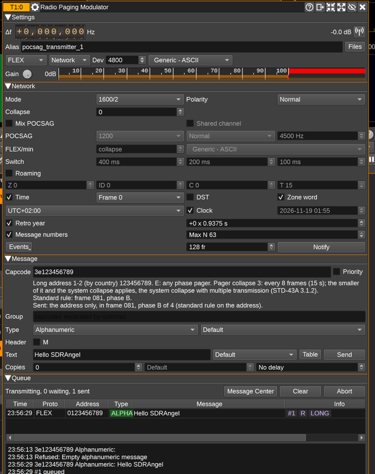
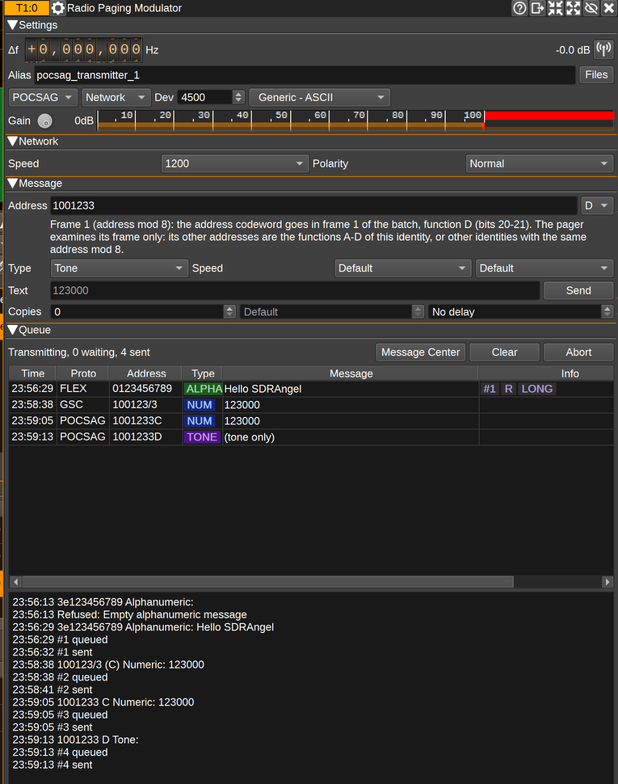
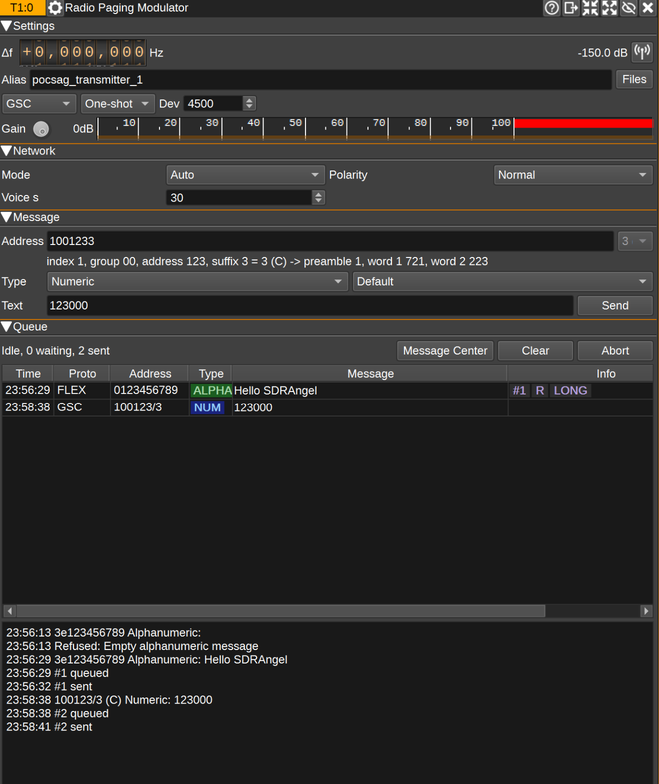

<h1>Radio paging modulator plugin</h1>

<h2>Introduction</h2>

This plugin transmits radio paging messages in one of three protocols:

* POCSAG at 512, 1200 and 2400 bit/s ([ITU-R M.584-2](https://www.itu.int/rec/R-REC-M.584/en))
* FLEX in its four modes 1600/2, 3200/2, 3200/4 and 6400/4 (ARIB RCR STD-43A)
* GSC (Golay Sequential Code, ITU-R Rep. 900-2 Annex I): tone, numeric, alphanumeric and voice pages

A channel transmits one protocol. Its settings are the defaults of the messages it sends; a POCSAG message may be sent at another speed and any message in another polarity. A FLEX channel in network mode can also send POCSAG messages mixed into the FLEX frames.

The symbols are shaped with a Gaussian filter and frequency modulated with the deviation of the channel. The power ramps up at the start of a transmission and down after its last symbol. The radio paging demodulator (demodradiopaging) receives what this plugin transmits.

Messages are queued from the composer of the channel window, from the Message Center (pages sent to the alias of the channel) or with the `tx` action of the WebAPI. A message that can not be sent is refused with the reason. At most 100 messages wait.

<h2>Modes</h2>

* One-shot - the carrier is on for each transmission and off after it. POCSAG: preamble and the batches of the message. FLEX: an emergency re-synchronization of at least 2^collapse frames, then the frames of the messages (sent with collapse 0: each message goes in the first frame). GSC is always one-shot.
* Network - the carrier is on all the time, with idle fill between the messages:
  * POCSAG: idle batches. The messages of other speeds and polarities are sent in turn, each group after its own preamble.
  * FLEX: frames on the time grid, cycle 0 frame 0 at the top of each UTC hour, idle frames when there is nothing to send. A message goes in the frame of its capcode for the network collapse, frame = (capcode / 16) mod 128 and phase = (capcode / 4) mod 4 (STD-43A Appendix A 3).

<h2>Protocols</h2>

<h3>POCSAG</h3>

The preamble is 576 bits of reversals. The address codeword goes in the frame of the 3 LSBs of the address, with the function A to D; a message never displaces the sync codeword, there is an idle or address codeword between two messages and the transmission ends with an idle codeword (M.584-2 1.2). Types: tone, numeric and alphanumeric.

<h3>FLEX</h3>

* Addresses: short and long capcodes. The capcode field also takes the forms of STD-43A Appendix A, `[P|Q|R|S][fff][b]<letter><address>` (for example `3E005237593`): only the address is sent, the composer shows the address type of Table A-1 and what the letters say about the pager.
* Messages: alphanumeric, numeric, special numeric, numbered numeric, tone, short message, HEX/binary (blocking length, mail drop, display direction, header message, status information) and secure messages; priority addresses. A tone only page is a short message with the tone only payload (every digit a space): pagers do not take an address without a vector, which the standard also allows for tone only.
* A message longer than a frame is sent in fragments over several frames.
* Group messages: up to 5461 pagers. Each pager gets a short instruction with a temporary address and the frame of the group message, then the message goes to that address in that frame (STD-43A 5.2).
* Network mode:
  * Collapse: pagers listen to one frame in 2^collapse.
  * Message numbering (STD-43A 8.4): the alphanumeric, HEX/binary and numbered short messages of each address are numbered from 0, up to the largest message number of the network.
  * Copies: a message can be sent again up to 15 times, with the same message number and R = 0, at an interval; its first transmission can be delayed.
  * Roaming: the system ID words with the local ID, coverage zone, country code and traffic management flags.
  * Date and time: date, time and time zone in the block information words, of the computer clock or of a date and time set; daylight saving; the system time zone by default. A year after 2025 can be sent as the latest year of 1994-2025 with the same calendar (retro year). The extended second of the zone word corrects the time a pager shows when the frames are not aligned to the second.
  * System Event Notification of the events checked, in every phase of each frame for the frames set.
  * Mixed with POCSAG (STD-43A Chapter 7): POCSAG messages are sent between FLEX frames after a 750 bps switching pattern, in the frames that are not FLEX (the first 2^collapse frames of each minute, or a number of frames a minute). On a shared channel the minimum FLEX activity is per 4 minutes.
* Kanji messages are sent as HEX/binary in Shift JIS (Qt 6 with ICU).

<h3>GSC</h3>

* Transmissions: auto (a batch of the messages of the same preamble value, a message alone after its own preamble), single, batch, or non battery saver (all queued messages of a polarity after one pattern).
* The address is the cap code with the address number 1 to 4 (function A to D), or 7 digits with the suffix digit.
* Voice pages: the voice of a WAV file, or of the microphone, after the alert time, then the turn off code. The voice length is limited by the voice setting (default 30 s). The voice sent is kept in WAV files.

<h2>Interface</h2>

The top and bottom bars of the channel window are described [here](../../../sdrgui/channel/readme.md)

The window is in four sections that can be rolled up.

<h3>Settings</h3>

* Frequency shift from the center frequency of the device.
* Channel power.
* Mute: no samples are output. A muted FLEX transmission ends; it starts again with the re-synchronization when unmuted.
* Alias: name of this transmitter, in the records of the messages it sends and in the names of the voice files. Empty: the frequency of the channel in Hz. The Message Center sends pages to a transmitter by its alias.
* Files: the files of the voice sent (GSC): how many are kept, the space they take, and deleting the old ones.
* Protocol of the channel and mode (one-shot or network). A change of protocol or mode ends the transmission and drops the messages waiting.
* Deviation of the outer symbol (Hz), default 4500.
* Codepage of the alphanumeric messages of the protocol, for the pages that have none.
* Gain (dB) and output level.

<h3>Network</h3>

* Speed (POCSAG) or mode (FLEX) or GSC transmission mode, and polarity: the defaults of the messages sent. Normal polarity: POCSAG binary 1 is a negative deviation, GSC binary 1 is a positive deviation, FLEX symbol 3 is the highest frequency.
* FLEX collapse, 0 to 7.
* GSC voice length in seconds.
* FLEX roaming and its system ID: coverage zone, local ID, country code, traffic management flags.
* FLEX time: time of frame 0 of the cycle (the standard) or of the frame that carries it, daylight saving, time zone word, time zone, computer clock or a date and time set, retro year, extra seconds.
* FLEX message numbers and the largest message number.
* FLEX System Event Notification: the events, the number of frames, and Notify (Stop while it is sent).
* Mixing with POCSAG: shared channel, POCSAG speed, polarity, deviation and codepage, the FLEX frames, and the switching patterns before each POCSAG speed (STD-43A 7.2: at least 400 ms before 512 bit/s and 200 ms before 1200 bit/s).

<h3>Message</h3>

The composer of a message:

* Address: POCSAG address 0 to 2097151 and function A to D; FLEX capcode and priority; GSC cap code and function. The line below the address says what it is: POCSAG the frame of the address; FLEX the address type, the pager phase, frame and collapse of the capcode form, and the frame and phase it is sent in; GSC the index, group and address digits, the preamble and the words.
* Group: FLEX group message, the capcodes of the pagers separated by commas.
* Type, polarity and (POCSAG) speed of this message: Default takes the network setting.
* FLEX short message type and source; HEX/binary header flags; secure message type.
* Text, with the codepage of the message and its table: a click on a character inserts it, `<0xNN>` sends any code. CR and LF are written as the symbols for carriage return and line feed (U+240D, U+240A, in the table), or as the characters themselves in the WebAPI. GSC voice: the WAV file, or the microphone and its audio input.
* Copies, interval and delay (network mode).
* Send (or Enter in the text) queues the message.

<h3>Queue</h3>

* State (idle, ramp up, transmitting, ramp down), the message being sent, the messages waiting and sent.
* Clear drops the messages waiting. Abort drops them and, in one-shot mode, ends the transmission being sent.
* Message Center opens the Message Center (and adds it when there is none).
* The table of the last messages transmitted: queued, sent or dropped, with the message number, fragments and copies of FLEX messages. A click on the icon of a voice message plays the voice sent. Double click on a message opens all the fields of its record. Right click on the header selects the columns.
* The log of the messages queued and of the requests refused.

<h2>Message records</h2>

Each message sent is published on the "messages" pipe as a message record (direction TX) with the protocol, mode, speed, address, polarity, type, text and the protocol fields in protocolData, the same keys as the records of the demodulator. Its state goes from queued to transmitted and sent, or dropped; pages of the Message Center report it back to the Message Center.

<h2>REST API</h2>

Settings: `RadioPagingModSettings` (channel type `RadioPagingMod`), all the settings above, and the ramps at the start and end of a transmission (`rampUpMs`, `rampDownMs`, default 5 ms, and `rampRange`, default 60 dB). Report: `RadioPagingModReport` with the state, the messages waiting (`queued`) and being sent (`inFlight`), the ids of the message being sent and of the last one sent, the number sent and dropped, the samples produced and the FLEX re-synchronization.

Actions: `RadioPagingModActions`:

* `tx`: a message. POCSAG: `address`, `function`, `speed`. FLEX: `capcode`, `priority`, `groupMembers`, `shortType`, `source`, `blocking`, `mailDrop`, `rightToLeft`, `headerMessage`, `statusInfo`, `secureType`. GSC: `capcode`, `function`. All: `protocol`, `type`, `text`, `polarity` (normal or inverted), `charset`, `retransmit`, `retransmitInterval`, `sendDelay`, `id`. 202 when queued, 400 with the reason when it is not valid for the channel or when 100 messages are waiting.
* `clear`: 1 to drop the messages waiting.
* `abort`: 1 to drop them and end the one being sent.
* `systemEvent` and `systemEventFrames`: start the FLEX System Event Notification of the events (0 stops it).

Example: send an alphanumeric message to POCSAG address 1234567, function D, on channel 0 of device set 1:

    curl -X POST "http://127.0.0.1:8091/sdrangel/deviceset/1/channel/0/actions" \
      -d '{"channelType": "RadioPagingMod", "direction": 1, "RadioPagingModActions": {"tx": {"address": 1234567, "function": 3, "type": "alphanumeric", "text": "HELLO"}}}'
