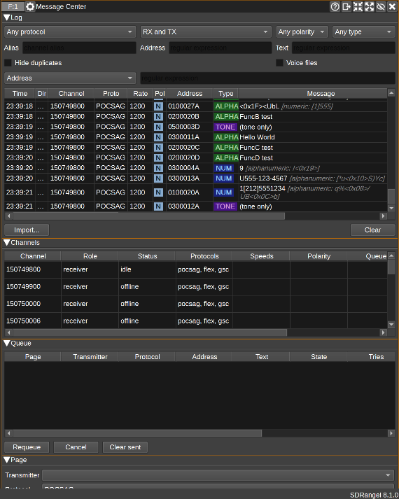
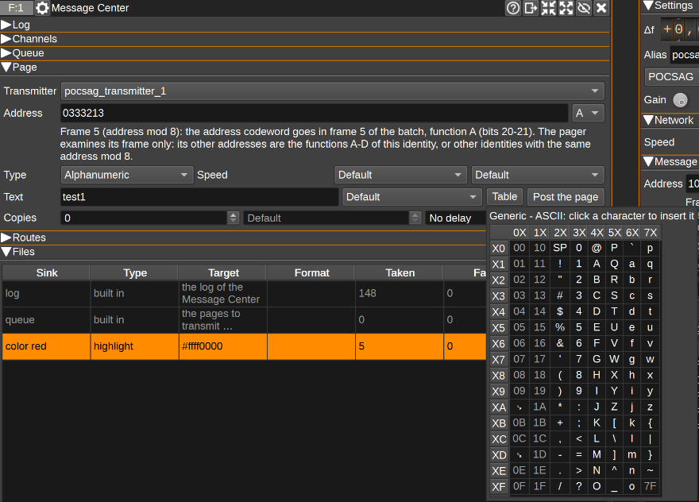
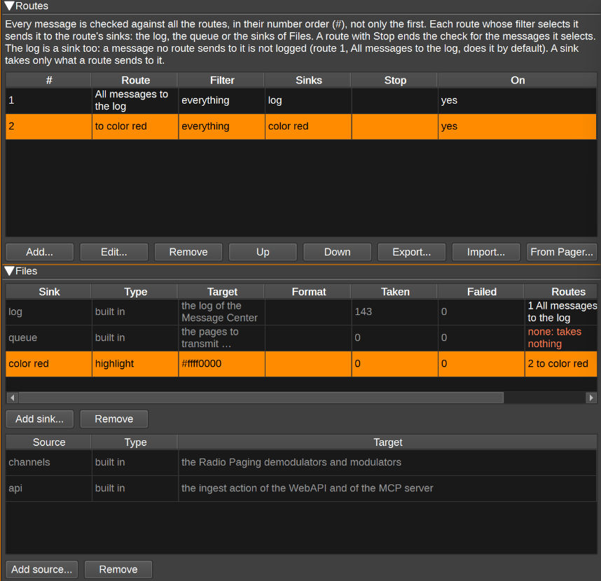
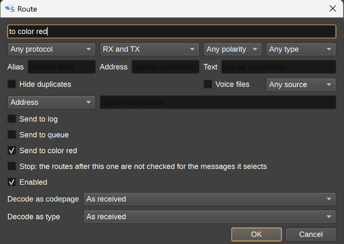

<h1>Message Center feature plugin</h1>

<h2>Introduction</h2>

The Message Center collects the messages of the radio paging channels (Radio Paging demodulator and modulator) in one log, routes them to files, and queues pages to the transmitters. It is the place where messages, events and voice messages are exchanged between the decoders and the encoders.

The channels publish their messages as message records on the "messages" pipe, and announce themselves with event records: the Message Center knows the receivers and transmitters without configuration. It is added like any feature, or with the Message Center button of the Radio Paging demodulator and modulator, which opens it (and adds it when there is none).

```
  source ---> routes 1, 2, 3... (filter) ---> sink(s)
  sources: the channels, the API, a JSON lines file, a CSV log, UDP datagrams
  sinks:   the log, the transmit queue, a JSON lines file, a CSV file, UDP datagrams,
           a command, speech, a highlight in the log, a position on the Map
```

<h2>Interface</h2>



The window is in sections that can be rolled up.

<h3>Log</h3>

The messages received and sent, newest at the bottom (at most the log size, the oldest go first).

* Filters: protocol, direction (RX, TX or both), polarity, message type, channel alias, address and text, hide duplicates, voice pages with a file only, and a regular expression on a field (see Routes). Address and text are regular expressions the whole field must match, as the filters of the other plugins of SDRangel: 12345.. for the addresses 1234500 to 1234599, .*FIRE.* for a text that contains FIRE, (?i) at the start for not case sensitive. An expression that is not valid is shown in red and selects nothing. Only the messages the filters select are shown. An address selects the FLEX group messages of which it is a member too (the members received with the assignments).
* The table has the columns of the message tables of the channels: time, direction, channel, protocol, rate, polarity, address, type, message, fragment, info, errors and state. Right click on the header selects the columns.
* A click on the icon of a voice message plays its file. Double click on a message opens a window with all the fields of its record: the common fields, protocolData (the flags and parameters of the protocol) and the raw payload, also as bits.
* Right click on a message: details, copy the cell, the row or the record as JSON, play the voice, select the audio output, and decode a received message again as the other type or with another codepage of its protocol.
* Decode as, All codepages...: a window with the message decoded with every codepage of its protocol (and as numeric, POCSAG and GSC), a row each; the reading shown is in bold. Right click on a row: Create route..., the route dialog filled to decode the messages of the address so.
* Create route... (right click on a message): the route dialog filled from the message: its protocol, polarity, type and address, to the log, with Stop. The tables of the Radio Paging channels have both too, for the Message Center there is (none: they are greyed out).
* Import: reads the messages of a file into the log: a JSON lines file, or a CSV log of a message center or of the Pager demodulator. They are logged, not routed, so no action is taken on them again.
* Clear: removes all the messages of the log, and of the history file when it is kept, after a confirmation. The items the map sinks put on the Map are removed too.
* A message a highlight sink took has its row in the colour of the sink.

<h3>Channels</h3>

The channels that announced themselves: alias, role (receiver or transmitter), status (online, or offline when it has not announced itself for the silent time), protocols, speeds, polarity, the pages queued to it, and the time it was last seen.

* A channel whose alias changes (the alias is the frequency by default) keeps one entry, of its new alias.
* Remove: removes the channel selected; it comes back when it announces itself again. Remove offline: removes the channels offline. The pages of a transmitter removed go back to the queue.

<h3>Queue</h3>

The pages to transmit, with the transmitter (alias), protocol, address, text, state, tries, retries and the reason of a failure. A page goes through pending, queued, claimed, transmitted and sent: the transmitter claims it and reports its state back. A page given to a transmitter that does not claim it within the claim timeout goes back to the queue; a page that can not be sent is dead.

* Requeue: a dead page goes back to pending with its attempts reset.
* Cancel: withdraws a page nobody has claimed, or a dead page.
* Clear sent: removes the pages sent.

<h3>Page</h3>



The composer of a page, the same as in the Radio Paging modulator: transmitter (alias), protocol, address, type, text and the fields of the protocol. Send queues the page for the transmitter.

<h3>Routes</h3>

Every message is checked against all the routes in their number order (#), not only the first. Each route whose filter selects the message sends it to the sinks of the route: the log, the transmit queue or the sinks of Files. A route with Stop ends the check for the messages it selects, so the routes after it do not see them. The log is a sink as the others: a message no route sends to it is not logged. A new Message Center has one route, 1 "All messages to the log", without a filter. A sink takes only what a route sends to it.





* Add, Edit (or double click) and Remove manage the routes; a route can be switched off. Up and Down change the order.
* Insert: where a new route goes, before route 1 by default, or before or after another.
* Decode as codepage and type: the messages the route selects are decoded again with the codepage and as the type before they go to its sinks; the routes after it get them as they were received. A message that cannot be decoded so (a codepage of another protocol, a transmitted message) is sent as it is.
* Export saves the routes, the sinks and the sources to a JSON file; Import replaces them with those of a file, after a check and a confirmation.
* From Pager makes the routes, sinks and sources that do what a Pager demodulator chosen from those there are does: a UDP sink and its route, a source that reads the rows its log gets from now on, and a route with speech, command, highlight and map sinks for each notification. Their names start with pager and the id of the instance (R0:1): an import again replaces them and deletes those no longer made; the others stay. A table lists each route, sink and source with what there is now, what the import makes and the action (add, update, delete, keep), and what the Pager demodulator has that is not imported, and why, before anything is changed.

The filter of a route has the fields of the filter of the log, and the source of the message: the channels, the API (ingest) or a source of Files. Its regular expression on a field of the message (address, message, protocol, type, channel, or any of them separated by spaces) matches anywhere in the field (^ and $ to anchor), as the notifications of the other plugins, and is case sensitive ((?i) at the start for not). Its captures are ${1}, ${2}... in the texts of the sinks the route sends to.

<h3>Files</h3>

The sinks and sources, each with a name and a type. The built in ones come first: the sinks log and queue, the sources channels and api. Double click to edit; a sink renamed is renamed in the routes too. The editor of a sink also chooses the routes that send to it, and can add a route that sends every message to it. The table of the sinks gives the records each took and refused and the routes that send to it (none: it takes nothing); the errors of the sinks and sources are below.

Sinks:

* file: records written to a file, in JSON lines (one record a line, lossless) or CSV (the columns of the record, header first).
* udp: a datagram for each message to an address and port. Pager format: the fields of the Pager demodulator, each ended by a NUL (date, time, address, function bits, alphanumeric, numeric, protocol, type); the address has 7 digits for POCSAG and 9 for FLEX, the function bits are POCSAG only, and the other reading of a message (numeric or alphanumeric) is in the other field. JSON format: the record as one line.
* command: a command run for each message. The command is split into the program and its arguments first, then ${address}, ${message}, ${protocol}, ${type}, ${channel}, ${mode}, ${id}, ${frequency}, ${time} (UTC) and ${0}, ${1}... (the captures of the route) are replaced in the arguments, so a message cannot add arguments or change the program. At most 5 are run in a second; the others are refused and reported.
* speech: the text, with the same replacements, is said (when SDRangel is built with text to speech).
* highlight: the row of the message in the log gets the colour.
* map: the position (latitude and longitude) in the text of the message is put on the Map, named by the address.

The actions (command, speech, highlight, map) are taken on messages only: not on events, nor on the end of a GSC voice message, which completes its page.

Sources:

* file: a JSON lines file; the lines added to it are read as they are written.
* csv: a CSV log of a message center (the columns of the record) or of the Pager demodulator (Date, Time, Address, Function Bits, Alpha, Numeric...); the rows added are read as they are written. New rows only: the rows already in the file are skipped.
* udp: datagrams received on an address (default 127.0.0.1, this computer only) and port: message records as JSON lines, or the Pager demodulator format. What is received is a message received: it never becomes a page to transmit.

<h3>Options</h3>

* Log size: messages kept in the log (default 10000).
* History: keep the log in the history file (messagecenter/history.jsonl in the application data directory), so that it is there again when the Message Center starts. One Message Center keeps the history. Over its size limit (default 50 MB) the file is written again with the newest messages of the log, up to half the limit.
* Claim timeout: a page given to a transmitter that does not claim it in this time goes back to the queue (default 10 s).
* Silent time: a channel that does not announce itself for this time is offline (default 20 s).

<h2>REST API</h2>

Settings (`MessageCenterSettings`, feature type `MessageCenter`): title, rgbColor, logSize, historyEnabled, historyMaxMB, claimTimeoutSec, silentSec, routes, sinks, sources and the reverse API settings. Routes, sinks and sources are JSON arrays (as text); a setting with a sink, source or route that is not valid is refused with the reason.

Report (`MessageCenterReport`): the number of messages logged and routed, the endpoints, the pages, the log, the records each sink took and refused (sinks) and the errors.

Actions (`MessageCenterActions`):

* `post`: a page to transmit (`MessageCenterPost`): transmitter alias, protocol, address, type, text and the fields of the protocol. The FLEX address takes the capcode forms of STD-43A Appendix A.
* `requeue`, `cancel`: the id of a page.
* `clearSent`: 1 to remove the pages sent.
* `redecode`: a record of the log decoded again (`MessageCenterRedecode`: id, charset, type).
* `ingest`: message records as JSON lines, routed as messages received.
* `importFile`: the path of a JSON lines or CSV file read into the log, not routed.

<h2>MCP</h2>

The MCP server feature has tools for the Message Center: `get_message_center` (routes, sinks, sources, channels, queue, sink counts, errors and the newest messages of the log), `set_message_center_routing` (routes, sinks and sources), `message_center_post_page`, `message_center_page_action` (requeue, cancel, clear sent), `message_center_ingest` and `message_center_import_file`. `get_paging_messages` gives the last 1000 messages of the paging channels whether or not a Message Center is there.
